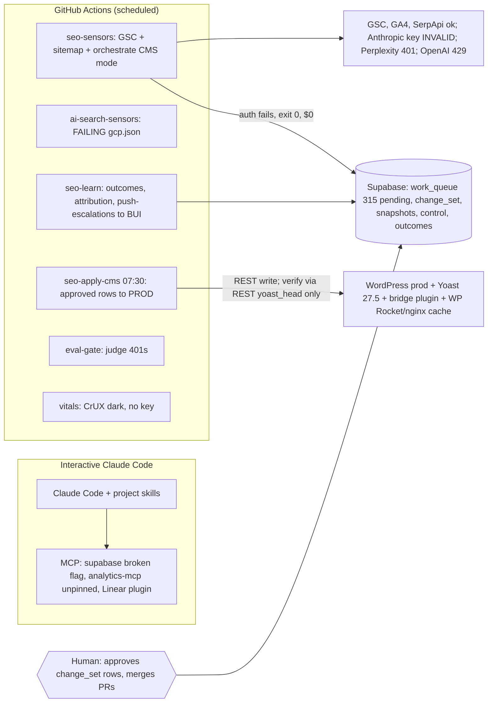
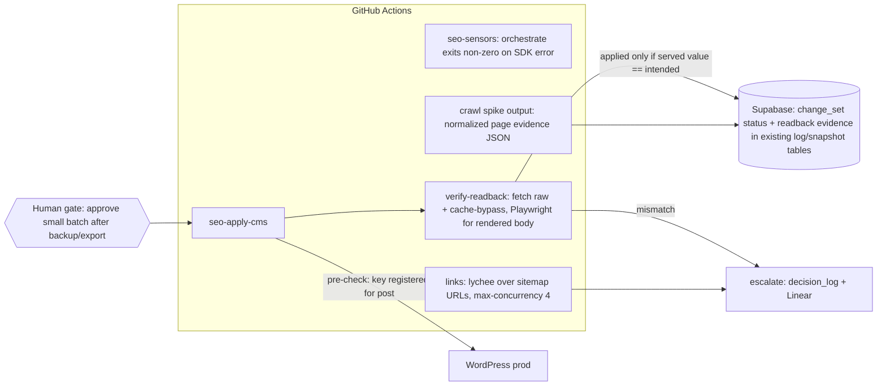

# SEO stack integration plan: open-source candidates against verified gaps

**Map:** SEO-1. **Date:** 2026-10-16. **Base:** `origin/main` 7a3d333. **Status:** research and
planning only. Nothing is installed or enabled, no paid call has been made, and nothing in
Supabase or WordPress has changed.

**Evidence files** (this folder):

- [`00-baseline.md`](./00-baseline.md): current repository state, stage owners, CI run evidence,
  and the open implementation lanes.
- [`10-candidates-01-10.md`](./10-candidates-01-10.md),
  [`11-candidates-11-20.md`](./11-candidates-11-20.md) and
  [`12-candidates-21-30.md`](./12-candidates-21-30.md): per-candidate verification. These files
  hold the installation dossiers, with verified commands, environment-variable names, smoke
  tests and rollback steps.
- Prior SEO-1 research on the `research/*` branches: crawl-render-approach,
  first-party-search-apis, seo-data-providers, wp-apply-surfaces and lead-attribution-path.

Evidence labels: **[V-me]** = I re-checked this myself in this session.
**[V]** = verified by a research agent from source, API or registry. **[U]** = unverified, with
the smallest test listed.

> **Limits of this planning session.** The Linear, Context7, Supabase and GitHub MCP servers were
> disconnected. The SEO-1 map body, its child tickets and their comments have **not** been read.
> The decision and implementation tickets in §9 are drafts to file once Linear reconnects, after
> de-duplicating them against the live map. Versions were checked against GitHub, npm and PyPI
> rather than Context7.

---

## 1. Executive recommendation

**Fix the pipeline before adding any tool.** The baseline shows that the closed loop does not
currently close.

1. **The orchestrator is not running, and CI reports success anyway [V-me].** The
   `seo-sensors` run on 2026-10-16 (id 38866248752) logs `Invalid API key · Fix external API key`,
   then `CMS run complete … (cost ≈ $0.00)`, and concludes `success`.
   - The cause is `orchestrator/run.mjs:160`: `/process exited with code 1/` is treated as a
     normal SDK shutdown, so a failed login looks the same as a clean exit.
   - PR #97 (spend accounting) adds a warning, but the job still passes.
2. **The CI `ANTHROPIC_API_KEY` is rejected** wherever it is used: the eval-judge, the citation
   analyst and competitor classification [V].
3. **`ai-search-sensors` has failed three weeks running** because of a `gcp.json` parse error;
   the quoting cause is [U]. **CrUX collects nothing** because no `CRUX_API_KEY` is set [V].
4. **315 queue items are pending with nothing consuming them**, and every learned pattern is
   negative [V]. The learning stage has nothing valid to learn from.
5. **Apply can record a write as applied when WordPress silently dropped it [V].** WordPress
   REST returns 200 and ignores writes to fields that are unregistered or have no update
   callback. `apply.mjs` checks only REST `yoast_head`, never the public HTML.

**Of the 30 candidates, adopt two at first, and both are free:**

| Adopt | Form | Gap closed |
|---|---|---|
| **Playwright 1.64.1** (Apache-2.0) | devDependency, Chromium only, called by a new read-back verifier | No rendered or public-HTML verification after apply; Elementor body edits cannot be confirmed |
| **lychee** (lychee-action v2.9.0, pinned SHA; lychee v0.24.2) | GitHub Action over the sitemap URL list | The repo has no broken-link check at all |

**Time-boxed spikes** that could change the plan. Each has a cost ceiling.

| Spike | Why |
|---|---|
| **SiteOne crawler v2.5.1** (MIT, single binary) vs a small fetch + Playwright crawler | Decides SEO-12's crawl approach without adding Crawlee |
| **`seo@0.5.0` CLI** (iannuttall, Apache-2.0) | Possible cheap read-only GSC/GA4 cannibalization report; telemetry off; possibly redundant with the existing `googleapis` sensor |
| **promptfoo 0.124.1** (MIT; OpenAI-owned since 2026-03) | Regression tests on skill outputs, the one gap the existing judge tooling does not cover |

**DataForSEO stays deferred** (top-up still unapproved). If it is used later, call the REST API
directly from Node for headless runs. Do not use the MCP server there: its generic
`api_request` tool can hit any paid endpoint with no spend cap.

**Everything else is deferred, rejected, already covered or reference-only** (§3). The
Python-based options (Scrapy, crawl4ai, trafilatura, advertools, sentence-transformers,
KeyBERT, python-seo-analyzer) do not justify adding a Python runtime to a Node repository with
about 240–300 pages.

---

## 2. Reliability versus outcome impact

| Change | Software reliability | Possible search or business impact |
|---|---|---|
| Fail the run when the orchestrator errors; fix the CI key | **High**: the loop actually runs | Indirect: a precondition for every SEO outcome |
| Fix the `ai-search-sensors` gcp.json write | Medium | Restores AI-referral and citation attribution input |
| Set a CrUX key | Low | Field CWV becomes visible; template CWV fixes become measurable |
| Field-registration pre-check plus read-back verification | **High**: applied means actually live | Prevents false "applied" outcomes from poisoning the learning step |
| lychee link check | Medium | Fixing broken internal links is a real but small crawl and UX improvement |
| Crawl spike (SiteOne vs custom) | Medium | Supplies normalized evidence for the internal-link and canonical work |
| promptfoo skill regressions | Medium | Fewer bad drafts reach human review |
| Cannibalization detection (GSC query overlap, then TF-IDF) | — | Directly targets the known restaurant-cluster risk |
| Lead/CRM wiring (lead-attribution-path) | — | **The only path to qualified-pipeline measurement**; ranking changes alone are not evidence of business value |

---

## 3. Verified inventory of all 30 candidates

| # | Candidate | Version examined | License | Class | One-line reason |
|---|---|---|---|---|---|
| 1 | iannuttall/seo | npm 0.5.0 | Apache-2.0 | CLI spike | Read-only GSC/GA4 reports through the existing service account. Telemetry must be off. Reject its hosted MCP (holds third-party tokens) |
| 2 | AgriciDaniel/claude-seo | v2.4.2 | MIT | Adapt selected | Borrow its seo-drift comparison rules. **Never run its installer**: it force-copies about 45 items into global `~/.claude` |
| 3 | dataforseo/mcp-server-typescript | 3.1.3 | (see 10-doc) | MCP, interactive only; **deferred** | Unbounded `api_request`. Headless runs should call REST directly. $50 minimum top-up |
| 4 | janreges/siteone-crawler | v2.5.1 | MIT | CLI spike | Single binary, JSON output, `--ci` gate. Never pass `--upload` |
| 5 | StJudeWasHere/seonaut | — | — | Reject | Web UI plus MySQL, no JS rendering, no API |
| 6 | GoogleChrome/lighthouse | 13.5.0 | Apache-2.0 | Already covered (PSI) | Run locally later only if PSI quota becomes a problem |
| 7 | GoogleChrome/lighthouse-ci | 0.15.1 (2025-06) | Apache-2.0 | Defer | Stale and still on Lighthouse 12. Its default public storage would expose reports |
| 8 | googleanalytics/google-analytics-mcp | 0.7.0 | Apache-2.0 | Already configured, interactive | Pin to `analytics-mcp==0.7.0`. Failed to connect this session; probably `uvx` not on PATH [U] |
| 9 | coreyhaines31/marketingskills | — | MIT | Reference | SaaS-oriented; contains paid vendor placements |
| 10 | pradeepoct/google-search-console-mcp | — | — | Reject | Detached copy, asks for Google Ads scope, duplicates the sensors |
| 11 | apify/crawlee | 3.18.2 | Apache-2.0 | Defer | Its anti-blocking stack is useless on our own small site |
| 12 | scrapy/scrapy | 2.19 | BSD-3 | Reject | Python; no gap it would fill |
| 13 | firecrawl/firecrawl | cloud + CLI | AGPL server / MIT SDK | Already covered | Do not add the SDK: it pulls zod 3, which conflicts with the repo's zod 4.4.3 |
| 14 | unclecode/crawl4ai | 0.9.5 | Apache-2.0 + attribution clause | Reject | Attribution clause for a public repo, stealth dependencies, root OS installs |
| 15 | microsoft/playwright | 1.64.1 | Apache-2.0 | **Install (devDependency)** | Single renderer for read-back |
| 16 | adbar/trafilatura | 2.3.1 | Apache-2.0 | Defer | Only once there is a programmatic or location-page uniqueness gate |
| 17 | eliasdabbas/advertools | 0.18.0 | MIT | Defer | Only once server access logs exist |
| 18 | lycheeverse/lychee | v0.24.2 / action v2.9.0 | Apache-2.0/MIT | **Run as CI action** | The repo has no broken-link check |
| 19 | GoogleChrome/web-vitals | 6.2.3 | Apache-2.0 | Defer RUM | Needs a gated production script injection; CrUX covers field data |
| 20 | sethblack/python-seo-analyzer | (2025-04) | BSD | Reject | Stale, no JS, canonical or JSON-LD checks, LLM proxy |
| 21 | google/schema-dts | 2.1.0 | Apache-2.0 | Reject | Types only; does nothing in a `.mjs` repo; schema-lint already covers it |
| 22 | garmeeh/next-seo | 7.3.0 | MIT | Reject | No Next.js target |
| 23 | iamvishnusankar/next-sitemap | 4.2.3 | MIT | Reject | No Next.js target; Yoast generates the sitemap |
| 24 | Yoast/wordpress-seo | 28.7 (live 27.5) | GPL-3.0 | Architecture reference | Source of the writable-field facts in §6.3 |
| 25 | huggingface/sentence-transformers | 6.1.0 | Apache-2.0 (weights separate) | Defer | Python and torch, too heavy for ~300 pages |
| 26 | MaartenGr/KeyBERT | 0.9.0 | MIT | Reject | Keyword extraction already covered |
| 27 | promptfoo/promptfoo | 0.124.1 | MIT | Defer → pinned `npx` spike | Skill-output regressions. Never use `apiKeyRequired:false`: it reads Claude subscription credentials |
| 28 | Lling0000/OpenCMO | — | no LICENSE file | Reject | Two ideas to rebuild from scratch: an AI-crawler robots.txt check and a passage citability score |
| 29 | unifapi-agent/agents | — | MIT | Reject; paid MCP deferred | Front-end for a paid hosted MCP |
| 30 | noduslabs/claude-seo-skill | — | no license | Reject | Front-end for a commercial MCP |

---

## 4. Existing-versus-proposed capability matrix (condensed)

The full table, with file paths, is in `00-baseline.md` §3.

| Capability | Now | Proposed | Owner |
|---|---|---|---|
| Orchestrator execution | **Broken**: auth fails, exits green | Fail on error; rotate the key | New ticket R-1; touches #97 lane |
| GSC sensor | Verified operational (67–70 items/night) | Keep | — |
| GA4 outcomes | Verified operational (weekly) | Keep; add lead events once the CRM decision lands | lead-attribution-path |
| CrUX | Configured, dark (no key) | Add `CRUX_API_KEY` secret | R-3 |
| AI-search sensors | **Broken** 3 weeks | Fix the gcp.json write | R-2 |
| SerpApi AIO/PAA | Verified operational | Keep; record sample independence (§6.4) | — |
| Crawl / internal links | Planned only (`link-graph.mjs` unscheduled) | Spike decides SiteOne vs custom | SEO-12 (per prior research) |
| Broken links | None | lychee action | I-2 |
| Apply field support | Implemented, unsafe (silent drops) | Registration pre-check plus value re-read | #104/#105/#109 lane |
| Rendered read-back | None | Playwright and fetch verifier | I-1 |
| Elementor detection | None | Detect `_elementor_data` / `elementor` markers on read; route body edits to the Elementor path (wp-apply-surfaces) | I-1 / wp-apply lane |
| CMS-path validation | Placeholder scan only | Run schema-lint, metadata and citation-density at change_set creation | I-4 |
| Skill-output regressions | None | promptfoo spike | E-3 |
| Cannibalization | None | GSC query overlap, then TF-IDF | I-5 |
| Lead / CRM | Planned only | Per lead-attribution-path | existing research |
| `change_set.change_type` | Code writes it; schema lacks it [U live] | Read-only live column check, then a migration only if missing | R-4 |

---

## 5. Architecture

### 5.1 Current state (as verified)



### 5.2 Proposed state (minimum viable stack)



**Boundaries:**

- Playwright and lychee run in CI and local Node only. Neither is reachable by the headless
  orchestrator's agent, which has no MCP tools. They are plain scripts.
- If either is unavailable, the job reports `verification: unavailable`. The change_set row then
  stays `applied_unverified`, never `applied`.
- To remove Playwright: `npm uninstall playwright`. To remove lychee: delete the workflow file.

---

## 6. Integration contracts

### 6.1 Read-back verifier (`scripts/verify-readback.mjs`, new)

Called after each apply batch, by `packs/wordpress/apply.mjs` or by a following workflow step.

**Input:**

```json
{ "change_set_id": "cs_…", "url": "https://www.maxxbuilders.com/<slug>/", "post_id": 123,
  "expected": { "title": "…", "metadesc": "…", "canonical": "…", "jsonld_types": ["Article"], "body_contains": ["<sentinel phrase>"] },
  "render": "auto" }
```

**Output** (one record per URL, stored in the existing `decision_log` / snapshot tables; no new
table unless R-4 shows these can't hold it):

```json
{ "url": "…", "captured_at": "2026-10-16T12:00:00Z", "verifier_version": "1",
  "fetch": [ { "variant": "served", "status": 200, "cache": { "x-cache": "HIT", "age": 312, "wp_rocket_comment": true } },
             { "variant": "bypass", "query": "mx_verify=<nonce>", "status": 200 } ],
  "rendered": { "engine": "playwright-chromium@1.64.1", "used": true, "reason": "elementor" },
  "checks": { "title": "match", "metadesc": "match", "canonical": "match", "jsonld": "match", "body": "mismatch" },
  "verdict": "mismatch_served_stale" }
```

**Semantics:**

- `served` is what visitors get. `bypass` is the origin's current output.
  - The bypass query-string behaviour is documented for WP Rocket [V]; for the front nginx
    cache it is [U].
  - A `served` mismatch together with a `bypass` match means a stale cache, not a failed apply.
- Head fields are checked against raw HTML; Yoast renders them server-side. Playwright is used
  only for body checks and Elementor pages.
- **Verdicts:** `match` | `mismatch_origin` (the apply failed) | `mismatch_served_stale` |
  `unverifiable` (fetch failed).
  - `applied` requires an origin match.
  - A served match is reported separately; it is not a gate, because cache purge is outside
    this repo.
- **Limits:** concurrency 2, a 15 s timeout per fetch, 2 retries with backoff, and a polite
  user agent identifying the verifier. Behaviour under Wordfence is [U].
- **Idempotency:** the key is `(change_set_id, url, verifier_version)`; reruns overwrite.
- **Logs:** URL, status and verdict only. Never response bodies or headers containing cookies.

### 6.2 Link check (lychee)

- **Input:** URL list derived from the sitemap (`SITEMAP_URL`).
- **Output:** lychee JSON, uploaded as an artifact.
- **Failures:** broken internal links become `work_queue` rows through `mem.mjs`, as safe-class
  `broken-link` items. External failures are reported only.
- **Cache:** `--cache --max-cache-age 1d`. Paid calls: none.

### 6.3 WordPress field writes (extends the #104/#105/#109 lane, not a new lane)

- **Pre-check:** `GET /wp-json/wp/v2/<type>/<id>?context=edit`. Confirm that each target meta key
  appears under `meta` for that post type. If it doesn't, classify `unsupported_field` and
  escalate; never write.
- **Post-check:** re-read the same endpoint and compare the value, then run §6.1.
- An HTTP 200 alone is never success.
- **Elementor:** if `_elementor_data` is present, a `post_content` edit is `unsupported_path` and
  is escalated (per wp-apply-surfaces) until an Elementor apply path is decided.
- **Drift:** keep #109's raw-to-raw drift check. The read-to-write race window remains; record
  `modified_gmt` at read and compare it at write as a best-effort guard [U whether REST honours
  `If-Unmodified-Since`].

### 6.4 SERP and AI Overview samples (existing SerpApi sensor)

Record `provider`, `engine`, `location`, `device`, `hl/gl`, `no_cache` and `search_id` on every
sample. Count only `no_cache=true` samples as independent; cached repeats are not new evidence.
Using `no_cache` costs credits, so `AIO_SAMPLES` stays the cap.

### 6.5 Spend

Represent spend as one of `{ cost_usd: number, cost_source: "sdk" | "estimate" | "missing" }`.
`missing` with an error fails the run (R-1). A legitimate zero is `cost_usd: 0` with
`cost_source: "sdk"` and a non-empty result.

---

## 7. Comparative evaluations (only those that can change a decision)

The pilot set is 10 URLs:

- the hotel, medical, warehouse, statewide, Houston and Dallas cost pages;
- the design-build service page;
- both restaurant pages (the cannibalization pair);
- one Elementor-built page, to be identified in the crawl.

| Eval | Decision | Baseline | Ground truth | Accept if | Reject if | Cost ceiling | Stop |
|---|---|---|---|---|---|---|---|
| E-1 Crawl | SiteOne vs custom fetch + Playwright | `link-graph.mjs` + Firecrawl audit (2026-10-14) | Hand-checked status, canonical, robots, internal links and JSON-LD types on the 10 URLs | ≥ 95% field accuracy, deterministic across 2 runs, < 10 min for the whole sitemap, no Wordfence blocks | Any missed canonical or noindex; needs Docker | $0 | 2 runs each |
| E-2 Read-back | Raw fetch vs Playwright for head and body checks | REST `yoast_head` | View-source plus DevTools on the 10 URLs | Playwright needed only for Elementor/body; raw fetch matches head 10/10 | Raw fetch misses a head field | $0 | — |
| E-3 Skill regressions | promptfoo vs extending `eval-judge` | `eval-judge` + `judge-calibrate` | 30 labelled skill outputs (metadata + schema) | Catches ≥ 3 seeded regressions the judge misses; < $2/run | No incremental catches | $5 total | 3 runs |
| E-4 Cannibalization | `seo@0.5.0` report vs a 50-line GSC query-overlap script | none | Known restaurant pair plus a manual review of the top 20 overlapping queries | Finds the restaurant pair plus ≤ 20% false positives | Needs scopes beyond read-only | $0 | — |
| E-5 DataForSEO | **Not run** until the top-up is approved | SerpApi | — | — | — | needs approval | — |

These measure technical correctness only. Ranking or traffic changes from the follow-on fixes are
measured over at least 28-day GSC windows, compared with untouched control pages, and reported as
association, not causation.

---

## 8. Stacks and cost

Recurring costs that are already in place (SerpApi plan, Firecrawl plan, Anthropic API spend under
`MONTHLY_BUDGET_USD`) are **[U]**: they are not visible from the repository. Check them in billing
consoles and Supabase `control.spend_usd`.

| Stack | Adds | Added monthly cost |
|---|---|---|
| **Minimum viable** | R-1..R-4 repairs, Playwright, lychee, read-back verifier | **$0** (CI minutes are within the free tier [U for a private repo]) |
| **Balanced** | Minimum, plus crawl spike outcome, promptfoo regressions (~4 runs/week), CrUX key, cannibalization script | ≈ $5–10 Anthropic for promptfoo; CrUX free. Existing SerpApi/Firecrawl/Anthropic must fit with this under **$300** |
| **Deferred / advanced** | DataForSEO (≥ $50 top-up), web-vitals RUM (production script injection), Python NLP, Lighthouse CI, Crawlee | Needs approval |

---

## 9. Phased sequence and draft tickets

**Serialization:**

- R-1 touches `orchestrator/run.mjs`, which is also the #97 lane. Fold R-1 into #97, or merge #97
  first.
- §6.3 rides the #104 → #105 → #109 stack; do not open a parallel lane.
- I-1 depends on that stack merging.

### Phase 1: repair the existing evidence and execution paths

| Draft | Type | Scope | Acceptance | Test | Rollback |
|---|---|---|---|---|---|
| **R-1** Orchestrator exits non-zero on SDK/auth failure | impl (fold into #97) | `run.mjs` CMS and repo paths: success needs a received `result` message; exit 1 otherwise | A forced invalid-key run exits 1, and the job is red | Reproduction test with a mocked SDK iterator that throws "exited with code 1" before any result → RED on main, GREEN after | Revert the commit |
| **R-0** Rotate/fix the CI `ANTHROPIC_API_KEY` | HITL task | Operator, in GitHub secrets | Judge and analyst succeed on the next run | Read the next run log | — |
| **R-2** Fix the gcp.json write in `ai-search-sensors.yml` | impl | One workflow line; state why, per the CLAUDE.md shared-infrastructure rule | Next weekly run is green; `attribute-citations` runs | Workflow dispatch | Revert |
| **R-3** Provision `CRUX_API_KEY` | HITL task | Operator | `sensor-cwv` writes rows | Run log | Delete the secret |
| **R-4** Verify the live `change_set.change_type` column (read-only) | research | Supabase read-only query | Column exists, or a migration ticket is filed | — | — |
| **R-5** Pass WP credentials to the orchestrate step (or make CMS mode explicitly skip with a non-zero code) | decision → impl | `seo-sensors.yml` | CMS mode can read WordPress, or explicitly declines | — | Revert |
| **R-6** `attribute-conversions.mjs` filters `action='applied'` | impl | One query | Conversions are attributed only to applied actions | Unit test RED/GREEN | Revert |

### Phase 2: read-only access and skills

| Draft | Type | Scope |
|---|---|---|
| D-1 Pin `analytics-mcp==0.7.0` in `.mcp.json` and fix `uvx` on PATH | decision + small impl | Interactive only |
| D-2 Adopt claude-seo drift rules as a project skill section (copy rules, not installer) | prototype | `.claude/skills/` |
| D-3 Retire or reframe `faq-schema` skill (Google deprecated FAQ rich results) | grilling | skill + queue items |
| D-4 Escalation target: BUI vs SEO team for `push-escalations.mjs` | grilling | ADR-010 follow-up |

### Phase 3: crawl, render and evaluation

| Draft | Type | Scope | Acceptance |
|---|---|---|---|
| **I-1** `scripts/verify-readback.mjs` (+ Playwright devDependency) | impl | §6.1 contract; wired after `wp:apply` | Pilot 10 URLs give correct verdicts; a deliberately wrong expected value gives `mismatch_origin` (red test) |
| **I-2** lychee link-check workflow | impl | New workflow (pinned SHA), concurrency 4 | Run lists known broken links; internal ones enqueue as safe items |
| E-1 / E-2 / E-3 / E-4 | research spikes | §7 | per table |

### Phase 4: approved execution paths

| Draft | Scope |
|---|---|
| §6.3 field pre-check and re-read | **inside the #104/#105/#109 stack** |
| **I-4** Run schema-lint, metadata and citation-density validators at change_set creation | `orchestrator/lib/*` |
| Elementor apply path | blocked on a wp-apply-surfaces decision |

### Phase 5: measure and expand

- **I-5** cannibalization detection (from E-4).
- Lead/CRM wiring per lead-attribution-path (Salesforce wiring [U]).
- Reconsider DataForSEO, RUM and promptfoo-in-CI against measured gaps only.

---

## 10. Decisions only the operator can make

1. Rotate the CI Anthropic key. It draws on a metered API pool.
2. Should a run that errors with $0 spend exit non-zero? **Recommended: yes.**
3. Fold R-1 into PR #97, or ship it as a separate PR after #97.
4. Approve Playwright and lychee as the only two new components for now.
5. Which spikes to run (E-1..E-4). All are $0 except E-3 (≤ $5).
6. DataForSEO top-up stays deferred (no record found in the repository; confirm in Linear).

---

## 11. Continuation prompts

**Research (after Linear reconnects):**

> /wayfinder work SEO-1. Load the map and its open children, and read every comment. De-duplicate
> the drafts in `docs/wayfinder/SEO-1/stack-integration/20-integration-plan.md` §9 against existing
> tickets; file only the new decision and research tickets as SEO-1 sub-issues with one
> `wayfinder:*` label each; wire `blockedBy`; append one-line gists to *Decisions so far*.
> Do not file implementation tickets.

**Prototype (E-1/E-2):**

> In a fresh worktree from `origin/main`, prototype `scripts/verify-readback.mjs` per §6.1 of
> 20-integration-plan.md against the 10 pilot URLs, read-only (GET only, concurrency 2). Install
> Playwright 1.64.1 as a devDependency only in that worktree. Record verdicts and runtime, and
> confirm or refute nginx cache bypass with `?mx_verify=`. No WordPress writes.

**Implementation (R-1):**

> In the #97 lane (`fix/spend-usd-accounting`), write a failing test: a mocked SDK `query()` that
> throws "Claude Code process exited with code 1" before yielding any `result` must make `runCms`
> exit 1. Watch it fail, then require a received `result` message for success. Run `npm test` and
> paste the counts.

**Independent review:**

> /review the R-1 and I-1 PRs, using the risk tier from `~/.claude/docs/review-doctrine.md`. Verify
> that each finding is reachable before reporting it. Confirm that no change marks a change_set row
> `applied` without an origin read-back match.
