# Full utilization plan: all 30 SEO candidates

**Map:** SEO-1. **Date:** 2026-10-17. **Base:** `origin/main` 7a3d333.
**Supersedes the scope, not the evidence, of** [`20-integration-plan.md`](./20-integration-plan.md),
which recommended a minimum stack. The operator then redrew the scope: *"add and utilize all 30
SEO candidates wherever technically and legally feasible."* This document does that. It keeps
every fact from the earlier files and changes only the dispositions.

**Evidence:**

- [`00-baseline.md`](./00-baseline.md): current repository state.
- [`10`](./10-candidates-01-10.md), [`11`](./11-candidates-11-20.md) and
  [`12`](./12-candidates-21-30.md): per-candidate source, licence, version and install facts.
- [`13`](./13-docs-grounding-node-ci.md) and [`14`](./14-docs-grounding-python-wp-services.md):
  Context7 plus vendor-docs grounding of every syntax this plan uses. **Pending.** Corrections
  from them are applied in §11.

Status words: **Proposed** = designed here, not built. **Configured** = in the repo, not yet
proven to run. **Operational** = proven by a run log read in a session. Nothing in this document
is installed or operational.

---

## 1. What the expanded system will do

Today the repository sees Google Search Console data, picks pages to improve, and drafts changes
that a person approves before they reach WordPress. It cannot reliably confirm what visitors
actually receive. It barely crawls the site. It has no regression tests for its own writing
skills. And the nightly agent run currently fails while reporting success.

After this plan, every one of the 30 projects has a defined job:

1. **Watch.** Nightly and weekly jobs gather search, analytics, crawl and speed evidence.
   - **Search:** the existing GSC sensor, with the `seo` command-line tool as a second opinion.
   - **Crawling:**
     - SiteOne for the fast weekly audit;
     - Crawlee for a monthly link-discovery crawl;
     - advertools for robots and sitemap tests, and later server-log analysis;
     - lychee for broken links.
   - **Speed:** PageSpeed Insights (PSI) for lab scores, Lighthouse and Lighthouse CI for
     template budgets, and Chrome's field data (CrUX) for real-user numbers.
2. **Understand.** An isolated Python toolbox pulls each page's main text with trafilatura,
   then scores similarity and keyphrases with sentence-transformers and KeyBERT. The aim is to
   find cannibalization, thin pages and internal-link opportunities. Optional paid providers
   (DataForSEO, UnifAPI, KeywordGraph) sit behind one interface and stay switched off until
   their spend is approved.
3. **Recommend and check.** Skills improved with adapted procedures from claude-seo and
   marketingskills write drafts. promptfoo regression suites and the existing eval-judge test
   them. JSON-LD comes from typed builders checked with schema-dts.
4. **Apply safely.** WordPress changes still go only through `change_set` → human approval →
   REST apply. Yoast's own source is the authority on which fields are writable. An upgrade to
   Yoast ≥ 28.6 is planned as a gated production change so the custom bridge plugin can retire.
5. **Prove it.** After every apply, a Playwright verifier reads the public page, as served and
   with the cache bypassed, and confirms the change is live. It measures lab web-vitals in the
   same session. An "applied" status then means the change is live.
6. **Measure business results.** GA4 (headless sensor, plus the analytics MCP for interactive
   exploration) and the planned CRM join report leads per landing page. Ranking changes alone
   never count as success.

Seven projects do not run as software here, and three more wait on paid accounts. Each still
gets a concrete, lawful role (§3).

**Not run as software:**

- **claude-seo** and **marketingskills:** adapted procedures (MIT).
- **next-seo** and **next-sitemap:** they need a Next.js site, and none should be built just to
  host them. They are reference patterns for the JSON-LD builders.
- **OpenCMO:** has no licence file, so its ideas are rebuilt from primary sources.
- **crawl4ai:** blocked by its licence clause and supply-chain risk. Playwright plus trafilatura
  replaces it.
- **pradeepoct GSC MCP:** asks for an unsafe Google Ads scope. #1's local tooling replaces it.

**Paid wrappers, blocked until spend is approved:** DataForSEO, UnifAPI, KeywordGraph. The
noduslabs skill text itself has no licence and is never copied.

**Two operator-only or one-off uses:** SEOnaut runs as a local Docker dashboard.
python-seo-analyzer runs once as a comparison baseline, and its BSD-3 rules are ported to Node.

---

## 2. Phase 0: what must be true before any of this

No new tool may depend on success records that can lie. These come first and are owned
elsewhere, so this plan does not duplicate them.

| Prerequisite | Evidence | Owner / ticket |
|---|---|---|
| Orchestrator exits non-zero when the SDK or auth fails | `run.mjs:160` swallows "exited with code 1". The 2026-10-16 log shows `Invalid API key`, then `$0.00`, then `success` | **No ticket yet.** Proposed R-1, folded into PR #97 lane (`fix/spend-usd-accounting`) with its owner |
| Valid CI `ANTHROPIC_API_KEY` | judge, analyst and classifier all 401 [baseline] | **Operator HITL.** Not fixed by any MCP work |
| `ai-search-sensors` gcp.json write fixed | 3 weekly failures [baseline] | No ticket yet (R-2) |
| Apply path fails closed and verifies | SEO-14, SEO-16, SEO-17, SEO-18, SEO-22, SEO-23, PRs #104/#105/#109/#110 | Existing lanes (SEO-9 decides the guarantee) |
| Field pre-check plus re-read (no silent 200) | Yoast 27.5/28.7 and WP 7.1.3 source (doc 12 §0.3) | Inside the #104/#105/#109 lane |
| Supabase MCP starts | `--read-only=false` crash | SEO-15 / PR #106 (other owner) |
| analytics-mcp starts | uvx missing; forced `gcp.json` | PR #111 plus operator setup |
| Live schema matches the committed schema | `change_type` column [U] | SEO-2 |

---

## 3. The all-30 integration matrix

**Dispositions** use exactly the operator's categories:

- **App:** direct application integration.
- **Dev/CI:** developer or CI tool.
- **Service:** separate service or isolated runtime.
- **WP:** WordPress-side integration.
- **Provider:** optional provider behind a shared interface.
- **Ref/Adapt:** reference implementation or adapted procedures, where the licence allows.
- **Blocked:** blocked pending a named prerequisite.

**Phases** (§7): **P0** repairs, **P1** read-only access and skills, **P2** verification
and crawl, **P3** analysis toolbox, **P4** gated execution paths, **P5** paid and expansion.

| # | Candidate | Useful capability (verified) | Current overlap | Disposition and method | Exact workflow (caller → trigger → output) | Prerequisites | Cost / month | Limitation | Phase |
|---|---|---|---|---|---|---|---|---|---|
| 1 | iannuttall/seo 0.5.0 | GSC/GA4 reports: cannibalization, decay, striking-distance, Google-update overlay; a local MCP mode **[U, doc 13 §11]** | `sensor-gsc`, `gsc-opportunity-mining` skill (LLM, no code) | **Dev/CI**: pinned `npx -y seo@0.5.0 … --json` | Weekly `seo-analysis.yml` → `report --section cannibalization,content-decay,striking-distance --json` → artifact → `scripts/import-seo-report.mjs` turns rows into `work_queue` candidates tagged `source=seo-cli`. Never used to apply anything | Service account read-only (already exists); `SEO_TELEMETRY_DISABLED=1` | $0 | Breaking command renames between releases (pin exactly); hosted MCP rejected (third-party token custody) | P1 |
| 2 | AgriciDaniel/claude-seo 2.4.2 (MIT) | `seo-drift` 17 comparison rules; dated schema deprecation facts; 26 skills | `cms-read`, schema-lint, project skills | **Ref/Adapt**: port rules into Node, with MIT attribution header | Post-apply: `scripts/validators/onpage-drift.mjs` compares the pre-apply snapshot with the verifier capture (#15) → `drift_findings[]` → escalate on severity ≥ high. Selected skill passages copied into project skills under non-colliding names | Read-back verifier (P2) | $0 | **Never run its installer** (force-copies into global `~/.claude`); its Python helpers are not used | P1 (rules), P2 (wiring) |
| 3 | dataforseo/mcp-server-typescript 3.1.3 | SERP, keyword volume, Labs, backlinks; `docs-search` | SerpApi (AIO), Yoast→Semrush proxy | **Provider** (headless: direct REST `providers/dataforseo.mjs`) **+ Dev MCP** (user-scope, interactive only) | `providers/serp.mjs` routes `rank`, `volume` and `backlinks` jobs to DataForSEO Standard queue (`task_post` → `tasks_ready` → `task_get`). Per-task `cost` goes to `control.spend_usd`. The MCP's generic `api_request` is never reachable headless | **Blocked:** $50 minimum top-up not approved (SEO-4, SEO-11) | Est. $11 (balanced) [SEO-4] | Daily spending caps exist (account-wide or per endpoint; error `40203`) [V doc 14], but no sub-account with its own balance. Free sandbox returns dummy data. Results via `task_get/advanced/{id}`. ToS restricts competing use | P5 |
| 4 | janreges/siteone-crawler 2.5.1 (MIT) | Single-binary crawl: 404s, redirects, headers, SEO/a11y/security checks; `--ci` gate (exit 10); JSON | none (`link-graph.mjs` unscheduled) | **Dev/CI**: pinned release binary in GitHub Actions | Weekly `crawl-audit.yml` → download v2.5.1 linux-x64, verify against GitHub's per-asset sha256 digest (no checksum files are published [V doc 13]) → `--url=<sitemap> --workers=2 --max-reqs-per-sec=2 --output=json` → artifact → `scripts/normalize-crawl.mjs` writes page-evidence JSONL (§5) → issues become `work_queue` rows | Wordfence tolerance (SEO-12) | $0 | v2.6.x tags have no binaries; `--browser` drops headers/cookies; `--ci` default minimums (10 pages/assets) fail single-page runs; **never `--upload`** | P2 |
| 5 | StJudeWasHere/seonaut (MIT) | Visual crawl dashboard and issue explorer | #4 | **Service**: operator-only, local Docker Compose, on demand | Operator runs `docker compose up` locally for a human investigation session, reads the dashboard, files findings by hand. No pipeline role: it has no API, and exports need a cookie login [doc 10 §5] | Docker (installed 29.7.2); change the sample DB passwords | $0 local | Stateful MySQL; can't be automated; duplicates #4 for machines | P5 (optional) |
| 6 | GoogleChrome/lighthouse 13.5.0 | Lab perf, a11y, SEO and best-practice audits | PSI (`check-vitals.sh`) | **Dev/CI**: `npx lighthouse@13.5.0` on the runner's Chrome 155 | Fallback when PSI quota or errors trip, and the primary for the a11y + SEO category audit of the 10-URL template set → JSON artifacts → `scripts/lh-summary.mjs` | ubuntu-24.04 Chrome (preinstalled) | $0 | Lab scores are not ranking evidence; run-to-run variance | P2 |
| 7 | GoogleChrome/lighthouse-ci 0.15.1 | Assertion budgets per URL; filesystem reports | `vitals-pr.yml` | **Dev/CI**: template regression gate | `lighthouserc.json` (10 template URLs, `numberOfRuns: 3`, assertions on LCP/CLS/TBT/SEO category), `upload.target=filesystem` → runs on `vitals-pr` and weekly | Template URL list | $0 | Bundles Lighthouse 12, not 13; **never `temporary-public-storage`** (public bucket); release is 16 months old | P2 |
| 8 | googleanalytics/google-analytics-mcp 0.7.0 | Read-only GA4 reports and funnels for an operator | Node GA4 sensor (headless) | **Dev MCP** (interactive only), `.mcp.json` | Operator asks ad-hoc GA4 questions (lead events by landing page) during SEO-10 attribution grilling. Headless GA4 stays on `sensor-ai-referrals.mjs` and `collect-outcomes.mjs` | PR #111; uv; user ADC (§6) | $0 | `cloud-platform` scope is mandatory in gcloud ADC login; transitive dependencies float | P0/P1 |
| 9 | coreyhaines31/marketingskills 2.11.37 (MIT) | `ai-seo`, `programmatic-seo`, `site-architecture`, `schema` procedures; `evals/evals.json` format | project skills | **Ref/Adapt**: passages adapted into existing skills; evals reused as promptfoo seeds | Adapted text in `restructure-for-citation`, `programmatic-plan`, `internal-linking` SKILL.md, with partner placements removed, MIT attribution, and a dated source note | — | $0 | SaaS-oriented; contains paid vendor placements that must be stripped | P1 |
| 10 | pradeepoct/google-search-console-mcp | GSC/GA4/Ads tools as a remote Worker MCP | sensors, #1, #8 | **Blocked, with replacement.** Not integrated | — | Requests full `adwords` scope; detached copy (attribution to JuJu78); Cloudflare Worker hosting | — | Unsafe scope | — |
| | ↳ *Lawful alternative* | GSC analysis for the operator | | **Headless:** #1 CLI in CI with the existing CI service-account secret. **Interactive:** #1's `seo mcp serve` exists at 0.5.0 [V doc 13], but it reads `GOOGLE_APPLICATION_CREDENTIALS` **service-account keys only**. A key inside Claude Code violates the global credential policy, so an interactive GSC MCP stays **blocked by policy** unless #1's user-OAuth login also works for `mcp serve` [U: smallest test in doc 13 §11] | | | $0 | | P1 |
| 11 | apify/crawlee 3.18.2 | Rendered link-discovery crawl beyond the sitemap (orphans, parameter URLs, delay-JS links) | #4 (raw), sitemap parser | **App** (CI script): `@crawlee/playwright` + #15 | Monthly `crawl-discover.yml` → `scripts/crawl-discover.mjs` (PlaywrightCrawler, same-hostname, maxConcurrency 2, maxRequestsPerMinute ~60) → URLs found ∖ sitemap URLs = orphan/leak candidates → page-evidence JSONL | #15; Wordfence tolerance | $0 | Anti-blocking dependencies unused on our own origin; storage dir must be ephemeral | P2 |
| 12 | scrapy/scrapy 2.19 | Crawl engine under advertools | #4, #11 | **Service** (Python sidecar, transitive dependency of #17) | Not called directly. Configured through advertools `custom_settings` (concurrency, delay, `ROBOTSTXT_OBEY`) | Python sidecar (§6) | $0 | No JS; Twisted runtime | P3 |
| 13 | firecrawl/firecrawl | Hosted render/scrape to markdown; map | ad-hoc CLI | **Provider**: `providers/render.mjs` fallback + existing CLI | Render routing: Playwright first. Firecrawl `/v2/scrape` over REST (no SDK, to avoid the zod 3 conflict) only when Playwright fails 2× or for **competitor** pages (content-gap briefs) → markdown into the brief inputs | `FIRECRAWL_API_KEY` (exists for CLI use) | $0 (Free 1k) to $19 (Hobby 5k) | AGPL server is not self-hosted; cloud ToS; credits don't roll over | P3 |
| 14 | unclecode/crawl4ai 0.9.5 | LLM-ready markdown extraction | #13, #16 | **Blocked** | — | (a) Legal sign-off on the appended attribution clause for a public repo; (b) security review of `unclecode-litellm` fork + stealth dependencies; (c) setup runs root `--with-deps` | — | — | — |
| | ↳ *Lawful alternative* | Same capability | | #15 render → #16 trafilatura markdown; #13 for third-party pages | | | $0 | | P3 |
| 15 | microsoft/playwright 1.64.1 | Rendered DOM, raw response, headers in one session | none | **App**: devDependency, Chromium only | `scripts/verify-readback.mjs` after each apply batch (contract in 20-doc §6.1); also the engine for #11 and the host for #19 lab metrics | Apply-path stack merged | $0 | Per-user browser cache (`PLAYWRIGHT_BROWSERS_PATH` to isolate) | P2 |
| 16 | adbar/trafilatura 2.3.1 | Main-content and metadata extraction; date extraction | none | **Service** (Python sidecar) | `tools/py/extract.py` calls `trafilatura.extract()` on Playwright-captured HTML (never fetches; on the CLI that means stdin or `--input-dir`, because `--input-file` and `-u` download URLs [V doc 14]) → `{url, main_text, title, date, word_count}` JSONL → uniqueness ratio (programmatic gate ≥ 0.5), thin-content flags, decay diffs | Python sidecar; page captures (P2) | $0 | Boilerplate heuristics may misjudge Elementor layouts; validate on the 10-URL pilot | P3 |
| 17 | eliasdabbas/advertools 0.18.0 | `robotstxt_test`, `sitemap_to_df`, crawl QA, `logs_to_df` | #4, `sensor-sitemap` | **Service** (Python sidecar) | Weekly: robots test of key URLs × [Googlebot, Bingbot, GPTBot, ClaudeBot, PerplexityBot, Google-Extended] (the AI-crawler check, rebuilding OpenCMO's idea from vendor docs) and sitemap audit (lastmod, status, non-canonical entries) → findings JSONL. **Log analysis blocked** until nginx access logs are exported | Python sidecar; host log access (unknown) | $0 | Single maintainer; `twython` dependency | P3 (logs P5) |
| 18 | lycheeverse/lychee 0.24.2 | Broken links / redirect targets, cached, rate-aware | none | **Dev/CI**: lychee-action pinned SHA `e747777…` | Weekly `links.yml` → sitemap URL list → `--max-concurrency 4 --cache` → JSON → internal broken links become safe `broken-link` queue items; external ones are reported only | Wordfence tolerance | $0 | Raw HTML only (no delay-JS links; #11 covers those); the action doesn't verify the binary's sha256. With `format: json`, `failIfEmpty` and `jobSummary` are inert, so a zero-link run passes silently [V doc 13]. A follow-up step must assert `total > 0` from the JSON. URLs via `--files-from` work | P2 |
| 19 | GoogleChrome/web-vitals 6.2.3 | LCP/INP/CLS with attribution | CrUX, PSI | **App** (lab, in #15) **+ WP** (RUM, gated) | (a) Lab: `context.addInitScript({path: 'node_modules/web-vitals/dist/web-vitals.attribution.iife.js'})` (exposes `self.webVitals`; the file is passed by path because `dist/` isn't an exported subpath [V doc 13]) in the verifier → per-URL LCP/CLS with attribution on every read-back. (b) RUM: GTM custom HTML tag sends `web_vitals` events to GA4 → weekly GA4 pull | (b) gated production change + consent review | $0 | Lab ≠ field; INP needs interaction; RUM changes the live site | P2 (a), P4 (b) |
| 20 | sethblack/python-seo-analyzer | On-page warning set (title, alt, h1, lang, OG) | metadata validator, schema-lint | **Ref/Adapt** (BSD-3 rules ported to Node) **+ Service** (one-off eval baseline) | Port missing checks (alt text, `lang`, single h1, OG presence) into `scripts/validators/onpage.mjs` using repo thresholds (≤ 60 title, not its 70). Run once in E-1 as a comparison baseline, without `--run-llm-analysis`, through an ephemeral `uvx --from pyseoanalyzer==2025.4.3` from a **scratch directory outside the repo**. Its import-time `load_dotenv()` walks up the directory tree and would load the repo `.env` [V doc 14] | Separate from the sidecar (its pins `trafilatura==2.0.0`, `lxml==5.3.1` conflict) | $0 | Stale (2025-04); no canonical, robots or JSON-LD checks | P1 (rules), P2 (eval) |
| 21 | google/schema-dts 2.1.0 | schema.org types | schema-lint (runtime) | **Dev/CI**: devDependency + `typescript` for `tsc --checkJs` | New `scripts/lib/jsonld/*.mjs` typed **builders** (Organization, GeneralContractor, Article, BreadcrumbList) built from operator-truth data, replacing LLM-written raw JSON-LD. CI `tsc --noEmit --allowJs --checkJs --module nodenext --types node --ignoreConfig <files>` over the builders. TypeScript 7.0.2: since TS 6, Node types are off by default, and passing files next to a tsconfig errors (TS5112) [V doc 13]. schema-lint still runs on the output | `typescript` devDependency | $0 | Types are permissive (all optional); catches typos, not completeness | P3 |
| 22 | garmeeh/next-seo 7.3.0 | Next.js head/JSON-LD components | Yoast | **Ref/Adapt** (MIT patterns for #21 builders) **+ Blocked** for runtime use | Read its JSON-LD component props as a checklist for builder fields | **Blocked as software:** requires a Next.js surface (§6.4) | $0 | Peer `next`/`react` | P3 (ref) |
| 23 | iamvishnusankar/next-sitemap 4.2.3 | Sitemap/robots generation for Next.js | Yoast sitemaps | **Ref** **+ Blocked** | Its robots/sitemap policy options become a checklist for the #17 sitemap audit | **Blocked:** Next.js surface; a second sitemap would duplicate Yoast's | $0 | Last release 2023 | P3 (ref) |
| 24 | Yoast/wordpress-seo (live 27.5; latest 28.7) | Head/schema output; REST meta from 27.7; `update-post-seo-data` ability from 28.6 | bridge plugin `seo-rest-bridge.php` | **WP** (already installed) **+ Ref** (source = writable-field authority) | (a) Now: apply pre-check reads `meta` keys registered for the post type; post-write re-read; `yoast_head_json` soft check. (b) Gated: upgrade to **≥ 28.7** after backup. The ability exists from 28.6, but `seo_title`, `meta_description` and OG/X inputs are accepted only from 28.7; developer.yoast.com still shows the 28.6 inputs [V doc 14] → retire the bridge → optionally route meta writes through the Abilities API (separate decision; ADR-005) | Production backup and export; SEO-8 inventory; SEO-9 guarantees | $0 (Premium licence existing [U]) | Native REST meta covers `post` only, not pages (28.7); no staging | P0 (a), P4 (b) |
| 25 | huggingface/sentence-transformers 6.1.0 | Embeddings for near-duplicate, cannibalization and internal-link scoring | none (TF-IDF proposed) | **Service** (Python sidecar, CPU torch, all-MiniLM-L6-v2 Apache-2.0) | Weekly `tools/py/similarity.py` over trafilatura main text → pairwise cosine + `community_detection` → pairs above threshold with a GSC query overlap → cannibalization candidates; top-k neighbours with no existing link → internal-link suggestions | Python sidecar; #16 output | $0 (CI CPU) | About 1 GB of wheels; model download cached; Node TF-IDF stays the fast path | P3 |
| 26 | MaartenGr/KeyBERT 0.9.0 | Page keyphrases (MMR diversity) | Yoast→Semrush proxy (demand), LLM | **Service** (Python sidecar, shares the #25 model) | Per page top-10 keyphrases → compare with the page's GSC queries: phrases a page *covers but never ranks for* → content-gap / anchor-text candidates for briefs | #25 | $0 | No demand data (pair with GSC or #3); release 2025-02 | P3 |
| 27 | promptfoo 0.124.1 (MIT, OpenAI-owned) | Declarative regression suites over skill outputs | eval-judge (gate), eval-benchmark (calibration) | **Dev/CI**: pinned `npx`, telemetry off | `evals/*.promptfooconfig.yaml` per skill (metadata-generate, schema-generate, blog-write) → `eval-skills.yml` on PRs touching `.claude/skills/**` → exit 100 fails the check. eval-judge stays the merge gate for content diffs | Valid `ANTHROPIC_API_KEY` (P0) | ≈ $1–8 | Never `apiKeyRequired:false`; Node ≥ 22.22 | P2 |
| 28 | Lling0000/OpenCMO | AI-crawler robots check; passage citability score | citation-density gate | **Ref** (ideas only; no code copied) **+ Blocked** (code) | Ideas rebuilt from primary sources: AI-crawler check via #17 using each vendor's published user-agent docs; citability heuristic considered for the citation-density gate | **Blocked as code:** no LICENSE file (pyproject claim only) | $0 | Passage-chunking heuristics conflict with the CLAUDE.md "no chunking" rule; adopt only what doesn't | P3 |
| 29 | unifapi-agent/agents (MIT skills; paid MCP) | LLM-mention / GEO tracking; backlinks via a hosted API | `sensor-ai-citations` (SerpApi), DataForSEO plan | **Provider** (paid, behind `providers/ai-visibility.mjs`) **+ Ref** (skills) | Monthly LLM-mention sample through its REST API (`UNIFAPI_API_KEY`) → compared with our own AIO capture as independent validation of AI-visibility trends | **Blocked:** paid account + data-use terms [U] | $5–20 cap (credits $0.001) [doc 12] | Vendor-reported metrics; another data processor | P5 |
| 30 | noduslabs/claude-seo-skill | KeywordGraph MCP: SERP topic graphs, text-gap analysis | keyword skills | **Provider** (interactive, user-scope MCP) **+ Blocked** (skill text) | Operator uses the KeywordGraph MCP interactively for topical-gap exploration when writing briefs. The skill text is **not** copied (no licence); write our own procedure | **Blocked:** subscription and pricing [U, doc 14 §13]; no licence for the skill | Unknown | Commercial; interactive only | P5 |

**Count:**

- **Run as software in some form: 23 of the 30.**
  - Unblocked now or after P0: #1, 4, 5, 6, 7, 8, 11, 12, 13, 15, 16, 17, 18, 19, 20 (one-off
    eval run), 21, 24, 25, 26, 27.
  - Paid and blocked until approval: #3, 29, 30.
- **Adapted procedures or reference only: 7 of the 30.**
  - Licence permits adaptation: #2 (MIT), #9 (MIT).
  - Pattern reference: #22, #23.
  - Ideas rebuilt from primary sources: #28 (no licence).
  - Blocked, with a named replacement: #10, #14.
- **Integrated as unlicensed code:** none.

---

## 4. How the capabilities work together

### 4.1 Workflow stages and assigned roles

```mermaid
flowchart LR
  A[Search and analytics evidence<br/>sensor-gsc · #1 seo CLI · GA4 sensor · #8 GA MCP interactive · SerpApi AIO · #3/#29 providers P5] --> B
  B[Crawling<br/>#4 SiteOne weekly raw · #11 Crawlee monthly rendered discovery · #17 advertools robots/sitemap · #18 lychee links · #5 SEOnaut operator-only] --> C
  C[Browser rendering<br/>#15 Playwright primary · #13 Firecrawl fallback/competitors] --> D
  D[Extraction<br/>#16 trafilatura main text · page-evidence JSONL] --> E
  E[Technical audit<br/>#4 checks · #20 ported on-page rules · schema-lint · #6/#7 Lighthouse/LHCI · CrUX · #19 lab vitals] --> F
  F[Keyword and topic analysis<br/>Node TF-IDF fast · #25 embeddings deep · #26 KeyBERT · GSC overlap · #1 cannibalization 2nd opinion · #30 interactive] --> G
  G[Content recommendations<br/>project skills + #2/#9 adapted procedures · #21 typed JSON-LD builders · #22 ref] --> H
  H[Evaluation<br/>eval-judge gate · #27 promptfoo regressions · citation-density] --> I{{Human approval<br/>change_set}}
  I --> J[CMS execution<br/>REST apply · #24 Yoast field authority · Elementor escalates]
  J --> K[Public-page verification<br/>#15 verifier served+bypass · #2 drift rules · #19 lab vitals]
  K --> L[Business measurement<br/>GA4 Lead · CRM join SEO-10 · #19 RUM P4]
  L --> A
```



### 4.2 Overlap routing: when each tool runs

| Capability | Primary (scheduled, production) | Fallback | Deep / on-demand | Independent validation | Comparative eval only |
|---|---|---|---|---|---|
| GSC analysis | `sensor-gsc` (nightly) | — | #1 `seo` CLI (weekly) | #1 vs `gsc-opportunity-mining` | — |
| GA4 | Node sensors (weekly) | — | #8 MCP (interactive) | — | — |
| Crawl, raw HTML | #4 SiteOne (weekly) | Node fetch over sitemap | — | #17 advertools sitemap/robots | #20 (once, E-1) |
| Crawl, rendered | #11 Crawlee (monthly) | — | #5 SEOnaut (operator) | — | — |
| Link status | #18 lychee (weekly) | #4 404 report | — | — | — |
| Render one URL | #15 Playwright | #13 Firecrawl after 2 Playwright failures | #13 for competitor pages | — | — |
| Main-content text | #16 trafilatura | Playwright `innerText` | — | — | — |
| Lab performance | PSI (per change) | #6 local Lighthouse on PSI error/quota | #7 LHCI template budgets (weekly, PR) | #19 lab in verifier | — |
| Field performance | CrUX (once the key exists) | — | — | #19 RUM (P4) | — |
| Similarity | Node TF-IDF (every audit) | — | #25 embeddings (weekly) | GSC query overlap | #25 vs TF-IDF on a labelled sample |
| Keyphrases | GSC queries + Yoast proxy | — | #26 KeyBERT | #3 volume (P5) | — |
| SERP / rank | SerpApi AIO (existing) | — | #3 DataForSEO (P5) | #29 LLM mentions (P5) | — |
| Skill quality | eval-judge (merge gate) | — | — | #27 promptfoo regressions | — |

### 4.3 Controls

- **Routing.** One module per capability (`orchestrator/lib/providers/{render,serp,ai-visibility}.mjs`).
  - Each exports `enabled()`, `estimateCost(job)` and `run(job)`.
  - `enabled()` is false unless its env flag (`PROVIDER_DATAFORSEO=on`, …) **and** its key are
    present. Absent means skip and log, never fail the pipeline.
- **Deduplication and caching.**
  - Cache key: `sha256(provider|endpoint|normalized_params|location|device)`, with a provider TTL
    (SERP 7 d, render 1 d, crawl 7 d).
  - Cached SERP repeats are **never** counted as independent samples (`no_cache` recorded).
  - Crawl artifacts are keyed by `(run_id, url)`.
- **Concurrency against our own origin.** A global ceiling of **4 concurrent / ~2 rps**:
  - SiteOne `--workers=2 --max-reqs-per-sec=2`;
  - lychee `--max-concurrency 4`;
  - Crawlee `maxConcurrency 2`;
  - verifier concurrency 2.
  - Origin-hitting jobs never overlap: separate weekdays, enforced through a workflow
    `concurrency:` group `origin-crawl`.
- **Spend.**
  - Every paid call is recorded with `{provider, cost_usd, cost_source}`.
  - The monthly per-provider caps live in `control` (proposed columns; migration gated) or, until
    then, in env vars `MAX_SPEND_<PROVIDER>_USD`.
  - The preflight refuses a job whose `estimateCost` would cross the cap. "Missing cost" is an
    error, never zero.
- **Interactive MCP vs headless** (both verified):
  - The orchestrator's `allowedTools` contain no `mcp__*` tools, so #3 (MCP), #8, #30, Supabase
    and Linear are interactive only.
  - Headless integrations are plain scripts or providers called from workflows.

---

## 5. Shared contract: page evidence

This is one normalized record per `(run_id, url, source)`. Every crawler, renderer and extractor
writes it. Storage is a **GitHub Actions artifact (JSONL)** first, kept out of git because the
repo is public. A Supabase table only follows if learning needs history (a gated migration
ticket).

```json
{ "run_id": "crawl-2026-10-20", "captured_at": "2026-10-20T07:00:00Z", "source": "siteone|crawlee|playwright|lychee|advertools|trafilatura",
  "source_version": "2.5.1", "url": "https://www.maxxbuilders.com/<slug>/", "final_url": "…", "status": 200, "redirect_chain": [],
  "fetch_mode": "raw|rendered", "cache": { "x_cache": "HIT", "age": 312, "variant": "served|bypass" },
  "head": { "title": "…", "meta_description": "…", "canonical": "…", "robots": "index,follow", "jsonld_types": ["Article"] },
  "content": { "main_text_sha256": "…", "word_count": 1450, "h1": ["…"], "elementor": true },
  "links": { "internal_out": 23, "broken": [] }, "findings": [ { "rule": "title_too_long", "severity": "medium" } ] }
```

URLs are normalized (lowercase host, strip fragment and tracking params, keep the trailing-slash
policy). Only `served` and `bypass` are cache variants.

---

## 6. Platform prerequisites

### 6.1 Isolated Python sidecar (#12, #16, #17, #20 one-off, #25, #26)

- **Location:** `tools/py/`, a uv **application** project. It holds `pyproject.toml` plus a
  committed `uv.lock`, and `requires-python = "==3.12.*"`. 3.12 is chosen for wheel coverage
  across torch, sentence-transformers and advertools.
- **CPU-only torch:** configured through `[[tool.uv.index]]` + `[tool.uv.sources]`. Exact syntax:
  doc 14 §2.
- **Interface:** CLI only. `uv run --locked python -m maxx_py.<tool> --in <jsonl> --out <jsonl>`.
  - No network access except the model download, cached via `HF_HOME`.
  - trafilatura never fetches; it reads captured HTML.
  - Node calls it only from workflow steps, never from the orchestrator agent.
- **CI:**
  - `astral-sh/setup-uv@1c37ad07a6a961277cf70c0d37d6f313000f5884` (v10.3.0; there is no
    floating `v10` tag) with `version: "0.13.0"`. The action embeds checksums only up to 0.13.0,
    so a newer uv needs an explicit `checksum` [V doc 14].
  - `uv sync --locked`, with the cache keyed on `uv.lock`. Runs on the weekly analysis workflow
    only.
  - The project is created with a plain `uv init`, which has included a build system since
    uv 0.12.
  - **Unverified:** whether the CPU torch index applies while torch is only a transitive
    dependency. If it doesn't, declare `torch` directly. Smallest test: `uv lock`, then inspect
    the torch source.
- **Kept out of this project:** pyseoanalyzer (#20). Its pins conflict, and its import-time
  `.env` loading is a credential risk, so it runs only as an ephemeral `uvx` from a scratch
  directory.
- **Local:** uv (the same winget install as the MCP setup) plus `uv sync`. The Python 3.12 that
  uv manages is separate from the system 3.14.
- **Removal:** delete `tools/py/` and the workflow job. Nothing in Node imports it.

### 6.2 Separate services

- **#5 SEOnaut:** local Docker only, with the operator's own DB passwords. Not deployed.
- **crawl4ai (#14):** not deployed (blocked).
- **LHCI server:** not deployed; filesystem target only.

### 6.3 WordPress (inspected via prior research; no live write)

- **Live plugin stack:**
  - Yoast Premium 27.5;
  - Elementor 4.0.7 / Pro;
  - WP Rocket 3.23;
  - Wordfence;
  - Redirection;
  - object cache;
  - an nginx front cache;
  - the WordPress MCP adapter (SEO-8 inventories it).
- **Duplicate-output rules:**
  - Yoast stays the **only** emitter of meta, sitemaps and JSON-LD.
  - New schema is added through Yoast's Schema API filters, not a second `<script type=ld+json>`
    (doc 14 §11d).
  - Elementor's Accordion, Toggle and Nested Accordion widgets have an **"FAQ Schema"** switch
    that emits a separate FAQPage JSON-LD block, which duplicates Yoast's graph [V doc 14].
  - Google no longer shows FAQ rich results [V doc 10].
  - Inventory those switches read-only (crawl `jsonld_types` per URL); turning them off is a
    gated Elementor edit.
  - Elementor Pro schema output is [U].
  - No next-sitemap or second sitemap.
- **Planned WordPress-side changes,** each a gated production change with backup, export and a
  small batch:
  1. Yoast upgrade to ≥ 28.7 (#24).
  2. A GTM web-vitals RUM tag (#19).
  3. Exporting nginx access logs (#17), which is a host action.

### 6.4 Next.js (#22, #23)

- **What would be required:** a separate Next.js property, for example a cost-calculator app or
  project-portfolio microsite on its own subdomain, in its own repo per ADR-0001. It would need
  its own hosting, analytics and SEO ownership.
- **Does it belong here?** No:
  - there is no business case on record;
  - it adds doorway and cannibalization risk against the WordPress cost guides;
  - this repo optimizes `maxxbuilders.com` only.
- **Use instead:** both stay reference patterns. They become software only if a Next.js property
  is onboarded through the repo-mode path.

### 6.5 Interactive credentials (MCP)

- **analytics-mcp:** user ADC, read-only GA4 **plus mandatory `cloud-platform`**. Effective
  access is those scopes ∩ the account's IAM and GA4 roles. Documented in `security.md` by PR #111.
- **DataForSEO MCP and KeywordGraph MCP,** if approved: `--scope user` (`claude mcp add`). Never
  in the repo's `.mcp.json`; credentials stay out of the repo.

---

## 7. Phased implementation specification

Each phase gets one lane per ticket. Files listed are proposed.

| Phase | Scope and files | Owner | Install / config | Acceptance tests | Operational evidence | Disable / remove | Depends on | Cost |
|---|---|---|---|---|---|---|---|---|
| **P0 Repairs** | R-1 `orchestrator/run.mjs` success = received `result`; R-2 `ai-search-sensors.yml`; apply stack (#104/#105/#109/#110); #106; #111 | #97 owner, apply-lane owners, operator (key) | None | Red-then-green test: mocked SDK throwing "exited with code 1" before `result` → exit 1 | Next nightly: an invalid key turns the job **red**; a valid key logs a non-zero cost and a result | Revert commits | — | $0 |
| **P1 Read-only access and skills** | #1 `seo-analysis.yml` + `scripts/import-seo-report.mjs`; #2 `scripts/validators/onpage-drift.mjs` (rules only); #9 skill passages; #20 `scripts/validators/onpage.mjs`; #8 verified | new lanes | `npx -y seo@0.5.0` (no dependency) | Unit tests: drift rules on fixture pairs (RED on a seeded regression); on-page rules with repo thresholds | One weekly `seo` run with a non-zero row count (a zero-row run counts as a failure) | Delete workflow or files | P0 key fix (for skill evals only) | $0 |
| **P2 Verification, crawl and quality** | #15 `scripts/verify-readback.mjs` + #19 lab; #4 `crawl-audit.yml` + `scripts/normalize-crawl.mjs`; #11 `scripts/crawl-discover.mjs`; #18 `links.yml`; #6/#7 `lighthouserc.json` + `lh-summary.mjs`; #27 `evals/` + `eval-skills.yml` | new lanes; verifier in apply lane after merge | `npm i -D playwright@1.64.1 @crawlee/playwright@3.18.2 @crawlee/utils@3.18.2` (`Sitemap` comes from `@crawlee/utils`); `npx playwright install --with-deps chromium` in CI on each run (Playwright advises against caching browsers in CI); SiteOne binary pinned; lychee-action SHA | Verifier: wrong expected value → `mismatch_origin` (red test); E-1/E-2 pilot pass criteria (20-doc §7); promptfoo seeded regression caught | Weekly artifacts with counts > 0; no Wordfence blocks in logs | Remove workflows; `npm uninstall` | P0 apply stack; SEO-12 spike (Wordfence, cache bypass) | $0 + ≈ $1–8 Anthropic |
| **P3 Analysis toolbox** | `tools/py/` (#12, #16, #17, #25, #26); #21 `scripts/lib/jsonld/*` + `tsc --checkJs`; #13 `providers/render.mjs`; #22/#23/#28 reference checklists | new lanes | uv project + lock; `npm i -D schema-dts@2.1.0 typescript@<doc13>`; `FIRECRAWL_API_KEY` reuse | Golden fixtures: extraction word counts within ±10% of hand counts on the pilot; similarity flags the known restaurant pair; builders fail `tsc` on a misspelled property | One weekly analysis artifact; cannibalization report reviewed by the operator | Delete `tools/py/`, the job and the devDependencies | P2 captures | $0–19 |
| **P4 Gated execution** | #24 Yoast ≥ 28.7 upgrade + bridge retirement; #19 GTM RUM tag; Elementor apply path decision | operator + WP lane | Production change windows with backup and export | Read-back verifier confirms the head unchanged after the upgrade; RUM events visible in GA4 DebugView | First week of RUM data; bridge removed without silent-200 regressions | Roll back the plugin version; remove the GTM tag | SEO-8, SEO-9, P2 verifier | $0 |
| **P5 Paid and expansion** | #3 `providers/dataforseo.mjs`; #29 `providers/ai-visibility.mjs`; #30 user MCP; #17 log analysis; #5 SEOnaut optional | operator approval per provider | Accounts; `--scope user` MCP adds | SEO-11 50-keyword coverage spike; per-provider spend cap honoured in a dry run | Spend rows equal provider invoices | `PROVIDER_*=off` | Budget approval | See §8 |

---

## 8. Costs (recurring, monthly)

Existing recurring costs are **[U]**: the SerpApi plan, Firecrawl plan, Anthropic metered usage,
and Yoast Premium renewal (annual). Check them in the billing consoles; the table marks them as
assumptions.

| Line | Local / OSS scenario | Hosted scenario | Full proposed stack |
|---|---|---|---|
| GitHub Actions (public repo) | $0 | $0 | $0 |
| All OSS tools (#1, 2, 4–7, 9, 11, 12, 15–21, 24–27) | $0 | $0 | $0 |
| Anthropic: promptfoo regressions | ≈ $1–8 | ≈ $1–8 | ≈ $8 |
| Anthropic: orchestrator + judge (existing) | budget cap `MONTHLY_BUDGET_USD` [U] | same | same |
| SerpApi (existing AIO) | assumption Starter $25 [U] | $25 | $75 (Developer, if rank moved to SerpApi instead of DataForSEO; not recommended) |
| Firecrawl (#13) | Free $0 | Hobby $19 | Hobby $19 |
| DataForSEO (#3) | — | ≈ $11 (balanced, SEO-4) after the $50 minimum top-up | ≈ $11–55 |
| UnifAPI (#29) | — | cap $10 | $20 |
| KeywordGraph (#30) | — | [U] | [U] |
| SEOnaut (#5) | $0 local | $0 local | $0 local |
| **Total (excluding [U] Anthropic base)** | **≈ $26–33** | **≈ $66–73 + KeywordGraph** | **≈ $133–177 + KeywordGraph** |

**What cannot fit under $300:**

- DataForSEO in Live mode on every job (≈ $135–169), plus SerpApi Production ($150), plus
  Firecrawl Standard ($83). That is ≈ $370–400.
- Any always-on hosted crawler (crawl4ai Cloud Builder at $99) on top of the paid SERP stack.

The tradeoff: Standard-queue SERP and cached renders keep the full stack under ≈ $180. Live-mode
freshness is reserved for ≤ 50 on-demand SERPs a month.

---

## 9. Blocked prerequisites (concrete)

| Blocked item | Unblocks | Needs |
|---|---|---|
| Valid CI `ANTHROPIC_API_KEY` | P1–P2 skill evals, judge, analyst | Operator rotation (metered) |
| PR #97 + R-1 | Truthful run status | #97 owner |
| Apply stack #104/#105/#109/#110 merged | P2 verifier wiring, P4 | Lane owners + operator merges |
| SEO-12 spike (Wordfence, nginx bypass on `?mx_verify=`) | P2 crawl/verify schedules | ≤ $0; operator sign-off per map notes |
| DataForSEO $50 top-up | #3 | Operator spend approval |
| UnifAPI / KeywordGraph accounts and terms | #29, #30 | Operator; terms review |
| crawl4ai attribution and supply-chain review | #14 | Legal + security sign-off (optional; alternative exists) |
| OpenCMO LICENSE file | #28 code reuse | Upstream action |
| nginx access-log export | #17 log analysis | Host access [U] |
| Next.js property | #22/#23 runtime | A business decision; not recommended |
| Yoast ≥ 28.7 upgrade window | #24(b) | SEO-8, SEO-9, backup |

---

## 10. Wayfinder and ticket plan

- **This file resolves one new research ticket on SEO-1:** *"How can each of the 30 candidate
  SEO projects be used, and what does the full stack cost?"* It graduates part of the map's
  "Agent capabilities" fog and **blocks SEO-13** (stack commitment, HITL grilling).
- **Implementation tickets are not filed from the map.** Per `docs/agents/issue-tracker.md`, a
  cleared map goes to `/to-spec` and then `/to-tickets`.
- **P0 defects are the exception.** R-1 (orchestrator false success) and R-2 (gcp.json write)
  are defects, not decisions, so they are proposed as standalone SEO issues. They are filed only
  with the operator's approval, and R-1 is coordinated with the #97 owner.

---

## 11. Docs-grounding corrections (applied above)

These came from docs 13 and 14 (Context7 plus vendor source at the pinned tags, 2026-10-17).
Earlier agents that were stopped are not counted as verification.

| Tool | Correction | Effect on this plan |
|---|---|---|
| seo (#1) | `seo mcp serve` exists at 0.5.0 but takes service-account keys only. 0.6.0 and 0.7.0 shipped 2026-10-17 and changed `internal-links` flags | Pin 0.5.0 exactly. Interactive GSC MCP blocked by credential policy (#10 row) |
| analytics-mcp (#8) | Pins `google-analytics-data==0.23.0`. `google-adk>=1.29.0` now resolves to **2.12.0** (major jump, untested with 0.7.0) | Recorded on PR #111 as a known risk. If startup fails, the fallback is `uvx --with "google-adk<2" analytics-mcp@0.7.0` [U] |
| Playwright (#15) | `goto` may return `null`; `headers()` omits cookies (`allHeaders()`); routing disables the HTTP cache; don't cache browsers in CI | Verifier handles a null response as `unverifiable`; no `page.route` during read-back |
| lychee (#18) | `--files-from` takes URLs; JSON format makes `failIfEmpty`/`jobSummary` inert; exit code in `steps.<id>.outputs.exit_code` | Add an explicit `total > 0` assertion step |
| web-vitals (#19) | IIFE at `dist/web-vitals.attribution.iife.js` → `self.webVitals`; `dist/` not exported | `addInitScript({path})` |
| LHCI (#7) | Bundles Lighthouse 12.6.1; `method: psi` ignores other collect options | Treat as a budget gate only; Lighthouse 13 via #6 |
| SiteOne (#4) | No checksum files (use the GitHub asset digest); `--ci` minimums of 10 pages/assets | Digest check; set `--ci-min-*` or skip `--ci` on single-page runs |
| schema-dts (#21) | TS 7.0.2; needs `--module nodenext --types node --ignoreConfig` | Command updated |
| Crawlee (#11) | `Sitemap` from `@crawlee/utils` | Dependency added |
| Firecrawl (#13) | Cached responses still cost 1 credit; no documented `Retry-After` | Our own cache in front; exponential backoff |
| DataForSEO (#3) | Daily spend caps (`40203`); free sandbox; `task_get/advanced/{id}` (Context7 path wrong) | Cap enforced at provider and in `control` |
| trafilatura (#16) | `--input-file` downloads URLs; HTML via stdin/`--input-dir` | Python API on captured HTML |
| advertools (#17) | The 0.18.0 wheel differs from master; adds `pyasn1`, `requests`; `serp_claude` behind an extra | Don't install the `claude` extra |
| pyseoanalyzer (#20) | Released wheel pins `langchain==0.3.22`, no OrcaRouter; LLM opt-in via `--run-llm-analysis`; import-time `load_dotenv()`; pins conflict with trafilatura 2.3.1 | Ephemeral `uvx` from a scratch directory, never in the sidecar |
| Yoast (#24) | Ability inputs for title/description/OG need **28.7** | Upgrade target ≥ 28.7 |
| Elementor | FAQ Schema switches emit a duplicate FAQPage | Inventory, then a gated toggle-off |
| setup-uv | v10.3.0 = `1c37ad0…`; checksums up to uv 0.13.0 | Pin both |
| unifapi (#29) | API-key bearer header accepted as well as OAuth | Headless provider possible with `UNIFAPI_API_KEY` |
| crawl4ai (#14) | Docker image still ships the stealth packages; `POST /crawl` exists | Stays blocked |

**Still unverified** (smallest test in docs 13 and 14):

- Elementor Pro schema output.
- setup-uv with uv 0.13.1 and no checksum.
- KeyBERT 0.9.0 with sentence-transformers 6.1.
- The CPU torch index when torch is only a transitive dependency.
- `seo mcp serve` with user OAuth.
- analytics-mcp 0.7.0 with google-adk 2.x.
